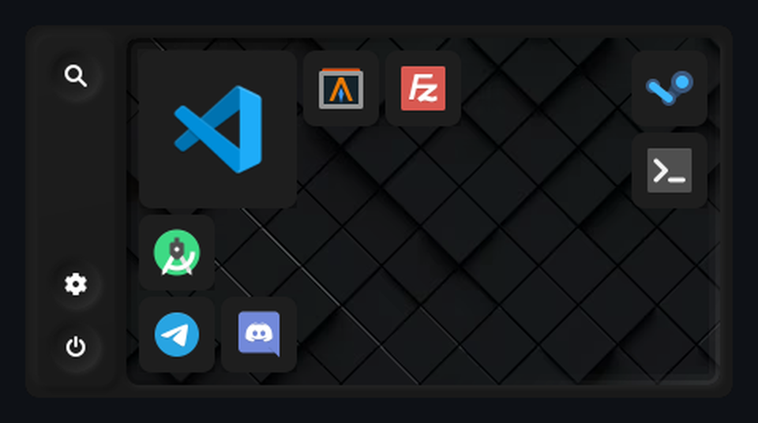
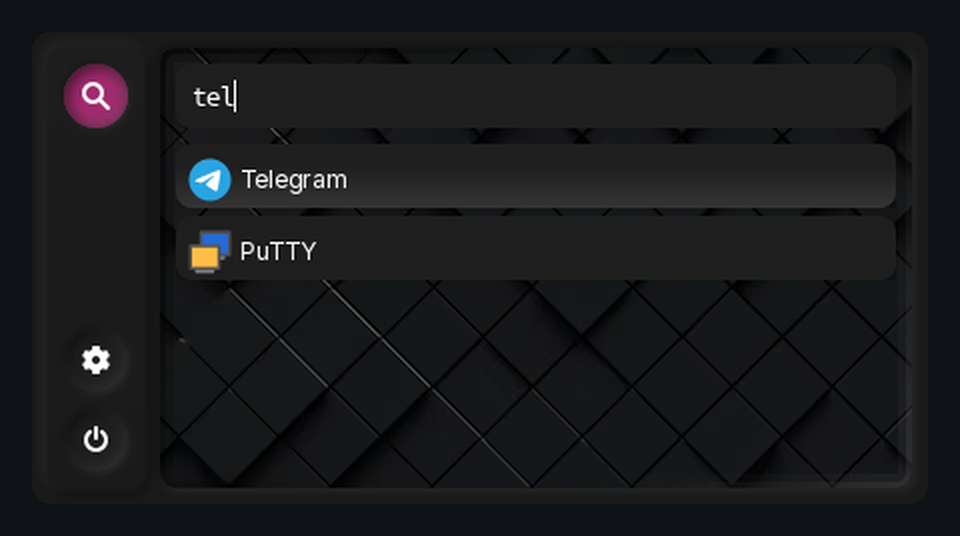
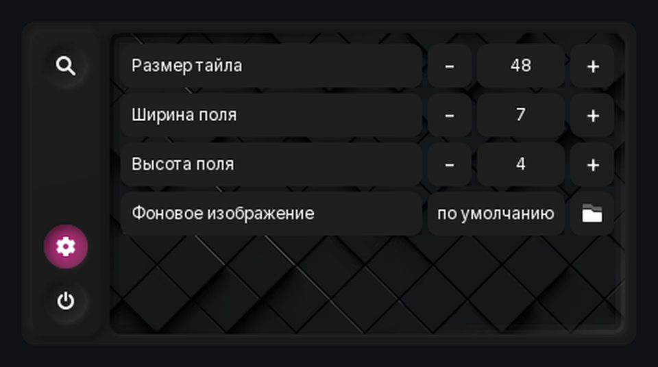
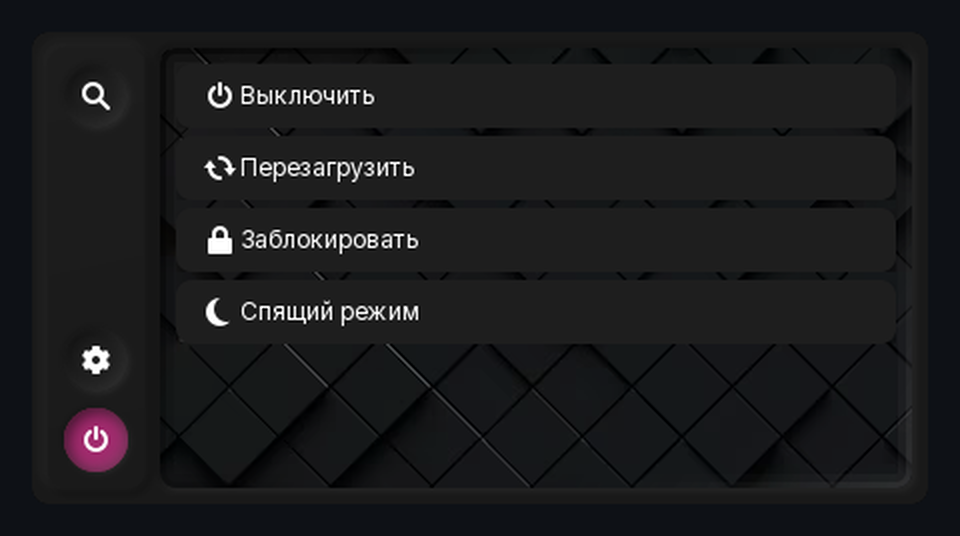

# BootMenu

Минималистичное меню запуска приложений для Linux в духе rofi: одно окно, сетка тайлов,
мгновенный поиск по установленным программам, настройки и управление питанием.

<p align="center">
  
</p>

<p align="center">
  
  
  
  
  
</p>

---

## Возможности

### Главная страница
- Сетка тайлов 7×4 по умолчанию, размеры 1×1 и 2×2.
- Перетаскивание с подсветкой целевой ячейки: соседние тайлы плавно раздвигаются
  уже во время перетаскивания.
- Правый клик по тайлу: «Размер» (1×1 / 2×2, выпадающий список) и «Открепить».
- Радиальная подсветка под курсором, как в макете.
- Раскладка сохраняется между запусками.

### Поиск
- Чтение `.desktop`-файлов из XDG-каталогов, Flatpak и Snap.
- Локализованные названия, `Keywords`, `GenericName`, скрытые и битые файлы учитываются.
- Ранжирование: точное имя → префикс → слово → подстрока → ключевые слова.
- Иконки: тема GTK → тема KDE/Qt → `Icon` из `.desktop` → заглушка.
- Навигация ↑/↓, Enter, плавная прокрутка и автопрокрутка только при выходе
  выделения за видимую область.
- Контекстное меню результата: «Открыть», «Закрепить»/«Открепить».

### Скриншоты

| Поиск | Настройки | Питание |
|:---:|:---:|:---:|
|  |  |  |
| Поиск по `.desktop` | Геометрия и фон | Питание |

### Настройки
- Размер тайла 32–64 px с шагом 4.
- Ширина поля 3–10 и высота 2–6; уменьшение блокируется, если тайлы не помещаются.
- Собственное фоновое изображение (PNG/JPEG), по умолчанию — фон из Figma.
- Изменения сохраняются и применяются пересозданием окна без перезапуска процесса.

### Питание
- Выключение, перезагрузка, блокировка, спящий режим.
- `systemctl` для питания, `loginctl` с fallback для блокировки.
- Действия выполняются сразу, без дополнительного подтверждения.

---

## Сборка

Требования: Linux, Go 1.23+, cgo, GTK 3 и `gtk-layer-shell`.

Debian / Ubuntu:

```sh
sudo apt install build-essential pkg-config libgtk-3-dev libgtk-layer-shell-dev
```

Arch:

```sh
sudo pacman -S base-devel pkgconf gtk3 gtk-layer-shell
```

Проверка зависимостей:

```sh
pkg-config --modversion gtk+-3.0 gtk-layer-shell-0
```

Сборка и запуск:

```sh
git clone <repository-url>
cd boot-menu
make build
./bin/boot-menu
```

Бинарник: `bin/boot-menu`. Запускайте его из терминала или повесьте на горячую
клавишу оконного менеджера.

---

## Конфигурация

Файл: `$XDG_CONFIG_HOME/boot-menu/layout.json` (обычно `~/.config/boot-menu/layout.json`).

```json
{
  "version": 2,
  "tiles": [
    { "app": "com.microsoft.VSCode.desktop", "x": 0, "y": 0, "span": 2 },
    { "app": "org.telegram.desktop.desktop", "x": 0, "y": 3, "span": 1 }
  ],
  "settings": {
    "tile": 48,
    "cols": 7,
    "rows": 4,
    "wallpaper": "/home/user/Pictures/wallpaper.jpg"
  }
}
```

- `span`: `1` — тайл 1×1, `2` — тайл 2×2.
- `wallpaper`: пустое значение — встроенный фон из Figma.
- Неизвестные приложения и тайлы за границами сетки отбрасываются при загрузке.
- Запись выполняется атомарно (временный файл + `rename`).

---

## X11 и Wayland

| Окружение | Поведение |
|---|---|
| X11 | override-redirect, без рамки, фиксированный размер, центрирование, скругления через shape mask, невидимое input-only окно для закрытия по клику вне лаунчера |
| Wayland + wlr-layer-shell (Sway, Hyprland, labwc) | layer-shell слой overlay, exclusive keyboard, центрирование композитором |
| KDE Plasma Wayland | layer-shell поддерживается |
| GNOME Wayland | layer-shell отсутствует: окно без рамки и фиксированное, но позицию определяет композитор |

Различия бэкендов инкапсулированы в `internal/win`; на X11 и Wayland используется
разный код управления окном, без ложных обещаний одинакового поведения.

---

## Особенности:

- `gotk3` закреплён на master-версии: стабильный v0.6.4 не собирается на Go 1.27.
- Дизайн: [Figma — BootMenu](https://www.figma.com/design/D9hu0L9LJoSljPcDA9flSa/BootMenu).
- Цвета и геометрия вынесены в `internal/theme`, поэтому пользовательские схемы
  можно добавить без переписывания UI.
---

## Ограничения

- Wayland проверен сборкой; runtime-тест требует композитора с layer-shell.
- На GNOME Wayland позиционирование окна не гарантируется.
- Popup-меню используют системное оформление GTK, а не тёмный стиль Figma.
- Действия питания выполняются сразу, без подтверждения.
- Нет глобального хоткея и single-instance режима.
- Приложения с `Terminal=true` не оборачиваются в терминал-эмулятор.
- Настройки геометрии применяются пересозданием окна (короткая перерисовка).